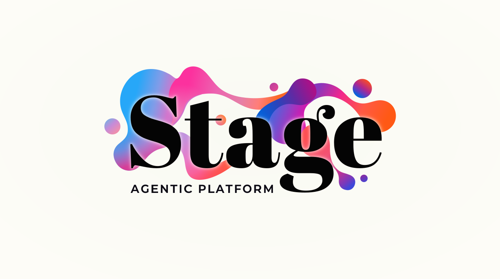

<p align="center">
  
</p>

# Stage

A local-first platform for running AI agents as Cloud Run jobs. You create a **task** (a prompt and the agent that should answer it), the control service starts the agent as a Cloud Run job, and you follow the run live in a React dashboard. State lives in Firestore, events travel over Pub/Sub, and everything runs on your machine against the [Floci](https://floci.io/floci-gcp/getting-started/quick-start/) GCP emulator.

```
Dashboard (apps/ui) ──► Control service (apps/control-service) ──► Cloud Run job per agent app (agents/*)
                              │                                         │
                              └────── Firestore · Pub/Sub ◄─────────────┘
```

## Quick start

You need [Bun](https://bun.com), Docker, [go-task](https://taskfile.dev), [Terraform](https://www.terraform.io/), [yq](https://github.com/mikefarah/yq) and a [Gemini API key](https://aistudio.google.com/apikey). Details and the expected output of each step are in the [Getting Started guide](docs/getting-started.md).

```bash
bun install
cp .env.example .env          # set GEMINI_API_KEY and uncomment the three *_EMULATOR_HOST lines
docker compose up -d floci-gcp floci-ui mlflow
task build                    # container images for the agents and services
task tf:init && task tf:apply # create the Cloud Run jobs and Pub/Sub topics in Floci
task register-agents          # record each job's agents in Firestore
```

Then start the API and the dashboard in two terminals:

```bash
bun run dev:service           # http://localhost:3000  (API docs at /docs)
bun run dev:ui                # http://localhost:5173  (dashboard)
```

Open <http://localhost:5173>, create a task for `stage--generic-agents--job-lcl` and run it.

## Repository map

| Path                                              | What it holds                                                                                       |
| ------------------------------------------------- | --------------------------------------------------------------------------------------------------- |
| [apps/control-service](apps/control-service)      | The Elysia HTTP API: tasks, sessions, events, providers, A2A ([plan](apps/control-service/PLAN.md)) |
| [apps/extract-service](apps/extract-service)      | Turns an uploaded document into text                                                                |
| [apps/ui](apps/ui)                                | The React dashboard, built with Vite and shadcn                                                     |
| [agents/](agents)                                 | One Cloud Run job image per agent app: `generic`, `poet`, `knowledge`, `orchestrator`               |
| [packages/agents](packages/agents)                | Runtime shared by the agent apps: job entrypoint, ADK runner, Firestore sessions, registry          |
| [packages/http](packages/http)                    | Plugins shared by the Elysia apps: request id, telemetry, config, errors                            |
| [packages/tools](packages/tools)                  | Reusable agent tools, such as `search_web`                                                          |
| [packages/ingestion](packages/ingestion)          | CLI that ingests documentation into Qdrant and Neo4j ([README](packages/ingestion/README.md))       |
| [packages/evals](packages/evals), [evals/](evals) | End-to-end agent evals ([README](evals/README.md))                                                  |
| [infra/](infra)                                   | Terraform for Floci and GCP ([README](infra/README.md))                                             |
| [docs/](docs)                                     | The documentation below                                                                             |

## Everyday commands

| Command                                   | What it does                                                                       |
| ----------------------------------------- | ---------------------------------------------------------------------------------- |
| `bun test`                                | Run the tests (with the emulator variables set, the Firestore tests need Floci up) |
| `bun run typecheck`                       | Type check the scripts and every workspace                                         |
| `bun run lint` / `bun run lint:fix`       | Lint with oxlint (`.oxlintrc.json`)                                                |
| `bun run format` / `bun run format:check` | Format with oxfmt (`.oxfmtrc.json`)                                                |
| `bun run eval`                            | Run the end-to-end agent evals (needs the stack, see [evals](evals/README.md))     |
| `task --list`                             | List every task: builds, Terraform, job helpers                                    |
| `docker compose down` / `down -v`         | Stop the stack / stop it and wipe local data                                       |

## Documentation

| Read this                                                                                                        | To                                                         |
| ---------------------------------------------------------------------------------------------------------------- | ---------------------------------------------------------- |
| [Getting Started](docs/getting-started.md)                                                                       | Set up the stack and run your first task                   |
| [Architecture](docs/architecture.md)                                                                             | Understand the components and how a run flows              |
| [Configuration](docs/configuration.md)                                                                           | Find an environment variable, pick a model, add a provider |
| [API](docs/api.md)                                                                                               | Call the control service: tasks, runs, sessions, events    |
| [Agents](docs/agents.md)                                                                                         | Know the agents, the registry, run modes and A2A           |
| [Observability](docs/observability.md)                                                                           | Send traces to MLflow, follow request ids                  |
| [Operations](docs/operations.md)                                                                                 | Build, deploy, migrate and troubleshoot Floci              |
| [Dashboard](docs/dashboard.md)                                                                                   | Use the web UI                                             |
| [Naming rules](docs/naming-rules.md) · [UI guidelines](docs/ui-guidelines.md) · [Floci notes](docs/floci-gcp.md) | Follow the conventions                                     |
| [Plans and reviews](docs/plans/README.md)                                                                        | Read design history and proposals                          |

## License

[MIT](LICENSE). The IMDb datasets that `task load-imdb` downloads are for non-commercial use only and are not covered by this license.
